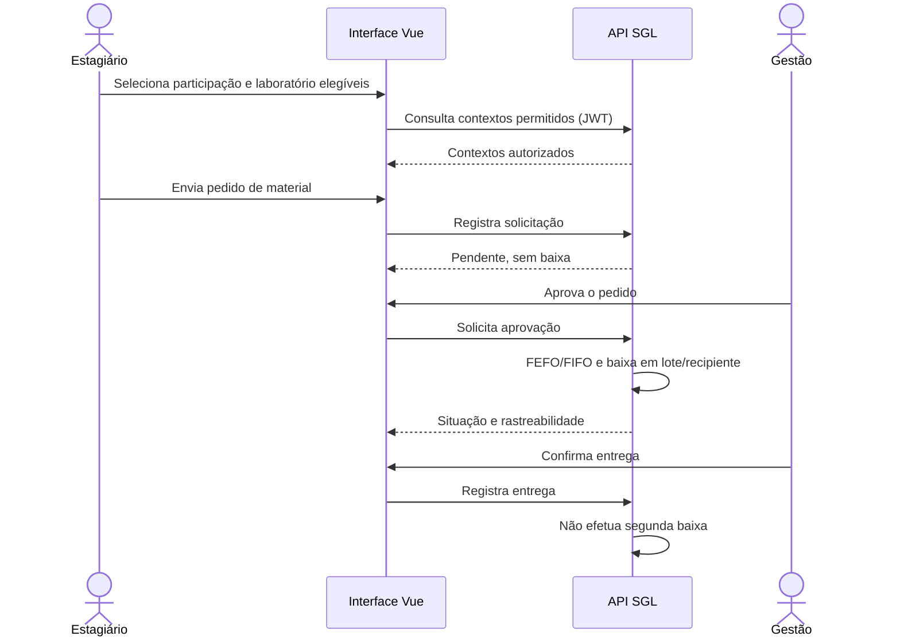
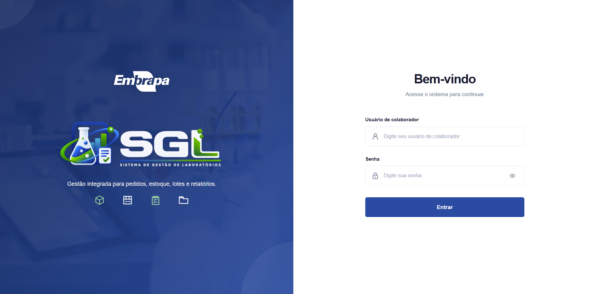

<a id="readme-top"></a>

<div align="center">
  

# SGL — Sistema de Gestão de Laboratórios

**Frontend corporativo para pedidos, estoque, lotes, resíduos, movimentações, relatórios, administração e acompanhamento operacional.**

`Vue 3` · `TypeScript` · `Vite` · `Pinia` · `Axios` · `Vuetify`

</div>

## O que é o SGL?

**A experiência web de um sistema que relaciona pessoas, laboratórios, pesquisas e materiais — com rastreabilidade até o lote e recipiente utilizados.**

Em laboratórios institucionais, um Pedido não começa no botão “Solicitar”: depende da **Unidade, do laboratório autorizado, do vínculo da pessoa e, quando aplicável, do Projeto, SCI e Atividade**. Depois do envio, o material precisa passar por análise, baixa física rastreável, entrega e relatórios. O SGL concentra essas jornadas numa aplicação com experiências próprias para solicitantes e Gestão.

Este repositório contém a interface **Vue 3 + TypeScript**; a API e as regras de negócio são mantidas no [SGL Backend](https://github.com/gbsalermo/Sistema-SGL).

| Quem utiliza | O que consegue fazer |
|---|---|
| **Empregado / solicitante** | Solicitar materiais ou soluções, informar resíduos e acompanhar seus registros |
| **Estagiário** | Operar a partir de participação elegível, laboratório permitido e vínculo vigente |
| **Orientador** | Acompanhar contextos e pedidos de orientandos conforme suas permissões |
| **Gestão** | Analisar Pedidos, preparar Soluções, movimentar lotes, acompanhar resíduos e indicadores |
| **Administração** | Gerenciar cadastros, vínculos, permissões e configurações autorizadas |

**Estado em novembro de 2026:** os fluxos principais, autenticação corporativa com JWT, Relatórios e rótulos estão presentes na `release`. A revisão técnica/documental avançou, mas **a homologação em staging, PostgreSQL/Flyway, carga, impressão física e jornadas reais Android/iOS ainda está pendente**. Não afirmar que a existência de CSS mobile equivale a usabilidade aprovada.

## Por que este projeto vai além de telas CRUD

- **Permissões ligadas ao trabalho real:** estagiários escolhem participações em Atividades de Projetos e só visualizam laboratórios elegíveis; empregados possuem regra distinta. **O backend confirma a autorização**, mesmo que o frontend filtre seletores.
- **Fluxo operacional de ponta a ponta:** Pedido, aprovação, lote e recipiente, baixa FEFO/FIFO, entrega e possível estorno aparecem como etapas distintas, com estados e mensagens apropriados.
- **Soluções e Resíduos não são meros produtos:** composição, preparo, informação de risco, componentes de catálogo ou livres, rótulos e ciclos próprios fazem parte da experiência.
- **Interfaces por perfil e contexto:** dashboards de solicitante e Gestão, participação em atividades, relatórios, alertas, busca e cadastros administrativos.
- **Documentos operacionais:** rótulos A4, exportação ZPL e impressão direta Zebra (Browser Print) para Produto, Resíduo, Solução e entrada de lote; exportações PDF/XLSX para Relatórios.
- **Uso institucional:** integração com identidade corporativa, isolamento por Unidade, modelos de autorização e Central de Ajuda contextual. A validação final de segurança e mobile permanece em aberto.

Esses diferenciais são **decisões de produto e engenharia do SGL**, não uma alegação de que tecnologias semelhantes não existam em outros sistemas.

## Papel do frontend

A aplicação organiza três experiências:

```text
SOLICITANTE
→ acompanhar o próprio contexto
→ solicitar materiais
→ informar e acompanhar resíduos

GESTÃO
→ dashboard operacional
→ pedidos
→ estoque/lotes
→ movimentações
→ resíduos
→ estagiários
→ relatórios

ADMINISTRAÇÃO
→ tudo da Gestão
→ Administração/Cadastros
→ alteração de perfis de usuários existentes
```

Regras críticas de domínio continuam no backend.

---

## Uma jornada no sistema

```text
Estagiário autenticado
  → escolhe participação elegível (Atividade / SCI / Projeto)
  → seleciona laboratório autorizado
  → informa itens ou solicita Solução
  → acompanha situação e mensagens em Meus Pedidos/Minhas Soluções

Gestão
  → analisa solicitação
  → aprova e registra baixa física por lote/recipiente
  → conclui entrega sem duplicar consumo
  → acompanha estoque, alertas e relatórios
```

**Resíduos seguem fluxo próprio:** o solicitante informa composição (produto cadastrado ou componente livre), local/contexto e risco; a Gestão avalia, libera e acompanha armazenamento/destinação. Isso não implica baixa automática de estoque por simples registro de composição.

### Visão da jornada entre interface e API

Exemplo **ilustrativo de pedido de material**; a autorização e a movimentação física são executadas no servidor. Este diagrama não representa um teste ponta a ponta homologado.



### Interface disponível neste repositório



A captura existente representa **a entrada do sistema**, não todas as jornadas. Imagens de Dashboard, Pedidos, Estoque e Relatórios devem ser adicionadas somente após captura recente, revisão visual e remoção de qualquer dado institucional ou pessoal. Não usar posters da Central de Ajuda como se fossem screenshots do produto. O [protocolo de capturas](docs/screenshots/README.md) identifica as próximas telas e os critérios de publicação.

---

## Stack

```text
Vue 3.5
Vite 8
TypeScript 5.9
Vue Router 5
Pinia 4
Axios 1.x
Vuetify 3.13
Node >= 20.19
```

Diretrizes:

- UUID público nas fronteiras com a API;
- Axios concentrado em `services`;
- Pinia para estado compartilhado;
- regras oficiais de estoque, FIFO/FEFO e transições no backend;
- interface em português;
- nomenclatura técnica em inglês apenas em eventual refactor futuro planejado.

---

## Arquitetura da interface e integração

```text
Navegador (SPA Vue)
  ├─ Vue Router → rotas e guardas UX por perfil
  ├─ Views / Components → formulários, tabelas, drawers e rótulos
  ├─ Pinia → estado compartilhado, sessão e contexto visível
  └─ Services (Axios) → contratos HTTP /v1/*
                              │ Authorization: Bearer JWT
                              ▼
                  Nginx encaminha /api
                              ▼
          SGL Backend (Spring Boot, regras e transações)
                              ▼
                    PostgreSQL + Flyway
```

**Responsabilidade por camada:** o frontend orienta a experiência, valida entradas para feedback e apresenta dados; **o backend autoriza a ação e executa as invariantes** (Unidade, participação, estoque, estados e persistência). Um usuário não ganha acesso apenas porque determinada rota ou botão aparece no navegador.

**Modelagem refletida na UI:** Unidade e laboratórios; Projetos → SCIs → Atividades; participação/vínculo de Estagiário; Pedido ou Solução com contexto elegível; Produto → Lote → Recipiente → Movimentação; Resíduo com composição e estados próprios. **Projeto pode envolver múltiplos laboratórios**, então a seleção não é uma árvore fixa de um laboratório por Projeto.

**Implantação:** o `Dockerfile` compila a SPA e o Nginx entrega os arquivos estáticos. O proxy `/api` mantém web e API na mesma origem na topologia de implantação. Os MP4 da Ajuda são servidos por volume externo, independentemente do build do frontend.

---

## Jornadas e rotas principais

**Fonte canônica:** `src/router/index.ts`. A tabela é uma seleção orientada à navegação, não uma cópia exaustiva do router. Algumas rotas exigem Gestão/Administração e o backend verifica permissões independentemente dos guardas de interface.

| Perfil ou experiência | Rotas representativas |
|---|---|
| Acesso e ajuda | `/login`, `/aguardando-aprovacao`, `/ajuda`, `/ajuda/:taskId` |
| Solicitante | `/inicio`, `/pedidos/novo`, `/meus-pedidos`, `/minhas-solucoes`, `/solucoes/solicitar`, `/residuos/novo`, `/meus-residuos` |
| Gestão | `/dashboard`, `/pedidos`, `/estoque`, `/estoque/:id`, `/movimentacoes`, `/solucoes`, `/residuos`, `/projetos`, `/estagiarios`, `/relatorios` |
| Administração autorizada | `/administracao/cadastros`, `/administracao/cadastros/vinculos`, `/administracao/unidades` (Administrador Geral) |
| Impressão | `/produtos/:id/rotulo`, `/residuos/:id/rotulo`, `/solucoes/:id/rotulo`, `/lotes/:id/documento-entrada` |

A aplicação usa guardas e layouts por perfil: solicitante, orientador, Gestão, Administração e Administrador Geral. **O inventário detalhado e histórico das telas** está em [`docs/INVENTARIO_TELAS.md`](docs/INVENTARIO_TELAS.md); versões anteriores de rotas nele devem ser confrontadas com o router da `release`.

---

## Sessão e contexto de Unidade

O login usa a conta da Embrapa (login de rede, ou CPF para colaboradores) e a senha da Embrapa. O backend valida as credenciais e devolve um JWT próprio do SGL.

```text
login + senha → POST /v1/auth/login → { token, expiraEm, usuario }
→ sessão persistida em localStorage, chave sgl.session (a antiga sgl.dev-session é apagada)
→ expira em 5 horas
→ interceptor envia Authorization: Bearer <token>
```

- Usuário `PENDENTE_VINCULACAO` só vê `/aguardando-aprovacao` ("Verificar novamente" consulta `/v1/auth/me`).
- 401 em rota protegida encerra a sessão e volta ao login; 403 com `USUARIO_PENDENTE` leva à tela de espera.
- A Unidade vem da sessão no backend. O header `X-SGL-Unidade-Id` só é enviado pelo **Administrador geral**, quando ele escolhe outra Unidade no seletor da barra superior.
- O botão "Entrar como desenvolvedor" aparece só quando o backend roda em `dev`/`demo` (`/v1/auth/config`).

Telas novas da gestão: aba **Pendentes** e **Importar da Embrapa** em Vínculos de usuários; **Unidades** (habilitação), só para o Administrador geral.

---

## Pedidos

### Solicitante

```text
/pedidos/novo
/meus-pedidos
```

### Gestão

```text
/pedidos
```

As operações seguem as regras de negócio executadas pelo backend:

```text
criação → não baixa estoque
aprovação → baixa estoque
entrega → sem segunda baixa
cancelamento aprovado → restaura lotes utilizados
perecível → FEFO
não perecível → FIFO
```

Urgência não muda FIFO/FEFO.

---

## Estoque e lotes

```text
/estoque
/estoque/:id
/estoque/lotes-vencendo
```

Cobertura:

- saldo consolidado;
- estoque mínimo;
- busca e filtros;
- entrada de lote;
- Código SGL;
- embalagem e multiplicador;
- fracionamento irreversível `false → true`;
- validade;
- descarte por vencimento;
- histórico/rastreabilidade;
- integração com dashboard, alertas e busca global.

Lotes continuam pertencendo ao contexto de Estoque; não há motivo para criar uma área principal independente.

---

## Resíduos

Decisão de domínio:

```text
Produto != Resíduo
```

### Solicitante

```text
/residuos/novo
/meus-residuos
```

### Gestão

```text
/residuos
```

Fluxo:

```text
INFORMADO
→ EM_ANALISE
→ LIBERADO_PARA_ARMAZENAMENTO
→ ARMAZENADO_TEMPORARIAMENTE
→ DESPACHADO
```

O Código SGL existe desde o registro inicial.

Rótulo:

```text
/residuos/:id/rotulo
```

O visual atual não utiliza QR Code.

Relatório:

```text
/relatorios/residuos
```

A interface permite utilizar modelos de resíduos cadastrados administrativamente, além do preenchimento manual, conforme o contrato do módulo.

---


## Estagiários e vínculos

A aplicação diferencia **a experiência do estagiário solicitante** das telas de **Gestão de estagiários**. Seu acesso operacional depende da situação de vínculo, de participações elegíveis em Atividades e dos laboratórios autorizados.

- O solicitante seleciona participação e laboratório válidos; não pode usar a liberdade de laboratório permitida para empregados.
- A Gestão acompanha registros, períodos, orientadores, treinamento de segurança, prorrogações, encerramentos e vínculos operacionais multilaboratório, respeitando permissões.
- A pessoa pode ser **importada da base institucional** pela Gestão; cadastro manual, importação e sincronização de eventos de estágio são processos distintos, não um único formulário.
- O dashboard, as solicitações e a Ajuda têm regras responsivas, mas a **jornada completa do estagiário em Android/iOS ainda não foi homologada**.

Rotas e serviços atuais incluem `/estagiarios`, `/administracao/cadastros/vinculos` e a importação corporativa da Gestão. Detalhes de contratos em [dossiê](docs/DOSSIE_PROJETO_SGL.md).

---

## Administração / Cadastros

```text
/administracao/cadastros
```

Acesso limitado aos perfis administrativos autorizados pelo router e pelo backend; `/administracao/unidades` exige `ADMINISTRADOR_GERAL`.

Áreas:

```text
Laboratórios
Projetos
Produtos
Permissões
Resíduos — modelos e cadastros reutilizáveis
```

Decisões:

- Unidade não tem CRUD manual normal;
- usuário não é criado manualmente nessa central;
- Permissões altera perfil de usuários existentes;
- Produto representa catálogo-base, não estoque;
- Laboratório respeita Unidade e responsável;
- Projetos preservam histórico por ativação/inativação quando necessário.

---

## Relatórios

Central:

```text
/relatorios
```

Relatórios presentes na `release`, com homologação integrada de filtros e exportações ainda pendente:

```text
Estagiários
Produtos
Projetos — relatório consolidado
Movimentações — Resumo / Detalhamento
Estoque e lotes
Fiscalização
Resíduos
Pessoas por laboratório
```

A opção **Movimentações** reúne contagens por tipo no modo Resumo e consulta de registros no Detalhamento. Os filtros do Detalhamento contemplam contexto Laboratório/Projeto/SCI/Atividade, produto, apresentação/unidade, origem e período. A quantidade física pode ser exibida opcionalmente e é identificada pela unidade real de medida. Estoque e lotes exibem apresentações e estados dos recipientes; Fiscalização inclui rastreabilidade por recipiente. As exportações PDF/XLSX recebem os filtros selecionados; a equivalência exaustiva dos resultados para todas as combinações ainda depende de testes.

A apresentação física e a quantidade consumida são conceitos distintos. A identificação histórica de consumo completo ou por medida é inferida dos detalhes registrados e não comprova a apresentação originalmente solicitada.

Pedidos entregues são recorte de Movimentações, não relatório separado.

Os filtros da prévia e da exportação são projetados para corresponder, mas o aceite de equivalência permanece aberto.

---

## Dashboard, alertas, busca e aparência

Dashboard da Gestão:

```text
/dashboard
```

Indicadores operacionais incluem:

```text
pedidos pendentes/urgentes
estoque baixo
lotes vencidos
lotes próximos do vencimento
resíduos aguardando ação / em análise
movimentações recentes
resumo por laboratório
```

Dashboard do Solicitante:

```text
/inicio
```

Shell integrado:

```text
Alertas operacionais            ✅
Busca global                    ✅
Tema claro/escuro               ✅
Persistência de preferência     ✅
Estilos responsivos implementados ✅ · mobile real ainda não homologado
```

O tema claro/escuro é aplicado às áreas autenticadas, mantendo a identidade visual própria da tela de acesso.

---

## Identidade e controle de acesso

```text
login corporativo + sessão JWT                 ✅
autorização das operações novas no servidor    ✅
Unidade derivada da sessão                     ✅
guardas de rota por perfil                     ✅ UX
matriz completa de permissões por módulo       ⏳
```

Visibilidade de menu/rota continua sendo só UX; quem decide é o backend.

---

## Evolução do projeto — referência de 17/11/2026

A `release` integra módulos que documentos de outubro descreviam como “aguardando merge”. Esse quadro reflete **código presente**, não homologação de desempenho ou segurança:

| Escopo | Verificação estática |
|---|---|
| Projetos, SCI, Atividades e Estagiários | Telas e services de gestão e participação presentes |
| Estoque, Pedidos e Soluções | Fluxos, fracionamento, baixa por aprovação e gestão presentes |
| Resíduos e Relatórios | Prévia, filtros, histórico e exportação presentes |
| Rótulos | Produto, Resíduo, Solução e Documento de Entrada com A4/Zebra/Browser Print; **teste físico pendente** |
| Multilaboratório | Regras de empregados e estagiários diferentes; participação elegível para Estagiário |
| Qualidade (Etapas 12–13) | Auditoria documental e de código avançada; **E2E, carga, PostgreSQL/Flyway e teste Android/iOS pendentes** |

**Riscos abertos:** autorização por objeto em consultas GET, desempenho do Dashboard e de Relatórios, consistência de quantidades físicas, compatibilidade API e acesso mobile. A documentação organiza os achados, mas **não os corrige nem os homologa**. O acompanhamento está no registro único de revisão do backend (`docs/REGISTRO_PENDENCIAS_REVISAO_SGL_2026-11.md`).
---

### Linha de evolução do produto

```text
Protótipo visual e experiência por perfil
  → cadastros, Estoque e Resíduos
  → Projetos, SCI, Atividades e vínculos de estágio
  → Pedidos/Soluções com contexto real
  → integração de estoque físico e relatórios
  → rótulos A4/Zebra e Central de Ajuda
  → JWT corporativo e estagiários multilaboratório
  → revisão técnica, responsividade e E2E cloud/mobile pendentes
```

O histórico das decisões e mudanças fica nos [guias das etapas](docs/README.md) e no [dossiê técnico](docs/DOSSIE_PROJETO_SGL.md). A auditoria encontrou e registrou riscos reais; ainda não há evidência suficiente para divulgar métricas de performance ou resultados de homologação mobile.

---

## Documentação

| Referência | Uso |
|---|---|
| [`CONTINUIDADE.md`](CONTINUIDADE.md) | Checkpoint atual e regras de retomada |
| [`docs/README.md`](docs/README.md) | **Índice técnico corrente** dos guias frontend |
| [`docs/DOSSIE_PROJETO_SGL.md`](docs/DOSSIE_PROJETO_SGL.md) | Stack, stores, services, rotas e contratos frontend |
| [`docs/GOVERNANCA_DOCUMENTAL.md`](docs/GOVERNANCA_DOCUMENTAL.md) | Fonte de verdade e separação histórica |
| [`docs/INVENTARIO_TELAS.md`](docs/INVENTARIO_TELAS.md) e [`docs/FLUXOS_NAVEGACAO.md`](docs/FLUXOS_NAVEGACAO.md) | Telas e jornadas |
| [`docs/PRESERVACAO_CENTRAL_AJUDA_VIDEOS.md`](docs/PRESERVACAO_CENTRAL_AJUDA_VIDEOS.md) | **Proteção obrigatória** dos 20 tutoriais, vídeo, poster, PDF e FAQ |
| [`docs/SINCRONIZACAO_GITLAB_GITHUB.md`](docs/SINCRONIZACAO_GITLAB_GITHUB.md) | GitLab `release`, GitHub espelho, branches `collab/*` e MR |
| [`docs/PLANO_TESTES_PRIMEIRO_PROTOTIPO.md`](docs/PLANO_TESTES_PRIMEIRO_PROTOTIPO.md) | Plano inicial histórico; não atesta execução recente |

No **backend**, consultar `docs/MATRIZ_COERENCIA_FRONTEND_BACKEND_2026-11-12.md`, `docs/REGISTRO_PENDENCIAS_REVISAO_SGL_2026-11.md` (31 itens) e `docs/PLANO_HOMOLOGACAO_NUVEM_MOBILE_2026-11-17.md` (CL-01–11, MB-01–12). Todos os novos problemas são registrados **num único backlog**, sem duplicações entre repositórios.
---

## Vídeos da Central de Ajuda

Os MP4 da Central de Ajuda (`/ajuda`) **não** vão para o git nem para a imagem: são servidos pelo Nginx a partir do volume externo `sgl_web_ajuda_videos`, montado somente leitura em `/usr/share/nginx/ajuda-videos/`. Os pôsteres (`public/ajuda/posters/`) ficam versionados.

1. Criar o volume, uma única vez por servidor. **Faça isto antes da primeira tag**: sem o volume, o `docker compose up` falha.

   ```bash
   docker volume create sgl_web_ajuda_videos
   ```

2. Copiar ou atualizar os vídeos (baixe os MP4 da pasta do Drive para um diretório no servidor, aqui `saida/`). Não precisa de novo deploy.

   ```bash
   docker run --rm -v sgl_web_ajuda_videos:/dest -v "$PWD/saida":/src:ro alpine sh -c 'cp /src/*.mp4 /dest/'
   ```

3. Em desenvolvimento, apontar para a pasta de saída dos manuais:

   ```bash
   ln -s ~/repos/sgl-manuais/saida public/ajuda/videos
   ```

4. Teste rápido (smoke test) após mudar o Nginx ou o `public/ajuda/`: construir a imagem, subir e conferir que `/ajuda` responde 200 (e não redireciona para `/ajuda/`, que é um diretório em `dist/`).

   ```bash
   docker build -t sgl-web:smoke . && docker run -d --name sgl-web-smoke -p 8081:80 \
     -e API_UPSTREAM=http://localhost:1 sgl-web:smoke
   curl -I localhost:8081/ajuda                      # 200 text/html
   curl -I localhost:8081/ajuda/sgl-guia.pdf         # 200 application/pdf
   docker rm -f sgl-web-smoke
   ```

---

## Execução e testes

Na raiz do repositório, com Node adequado à versão Vite do `package.json`:

```bash
npm ci
npm run dev
npm run type-check
npm run test
npm run build
```

`npm run test` usa Vitest + `jsdom`, com `src/**/__tests__/*.spec.ts`. Os testes de impressão Zebra `src/modules/rotulos/zebra/zpl.test.mjs` e `browserPrintLocal.test.mjs` usam `node:test` e **não entram no comando padrão**. O plano de execução deverá incluir os dois separadamente; ainda não foram executados nesta auditoria.

**Operação:** Dockerfile compila Vite com base `/api` e Nginx encaminha `/api` ao serviço `sgl-api` na rede compartilhada. Não reutilizar `docker-compose.yml` de produção para homologação sem substituir **rede, volumes, gateway e segredos** por versões isoladas.

**Mobile:** os formulários de Pedido, Solução e Resíduo possuem regras responsivas, mas **não há aceite em Android/Chrome ou iOS/Safari reais**. O plano do backend requer fluxo de Estagiário multilaboratório em celular, teclado virtual, toque, perda de rede, ausência de envios duplicados e E2E com API/PostgreSQL em staging.

---

<div align="center">
  <strong>SGL Frontend</strong>
  <p>Documentação consolidada sobre a <code>release</code>; revisão de código e referências concluída parcialmente, homologação integrada ainda pendente.</p>
</div>
